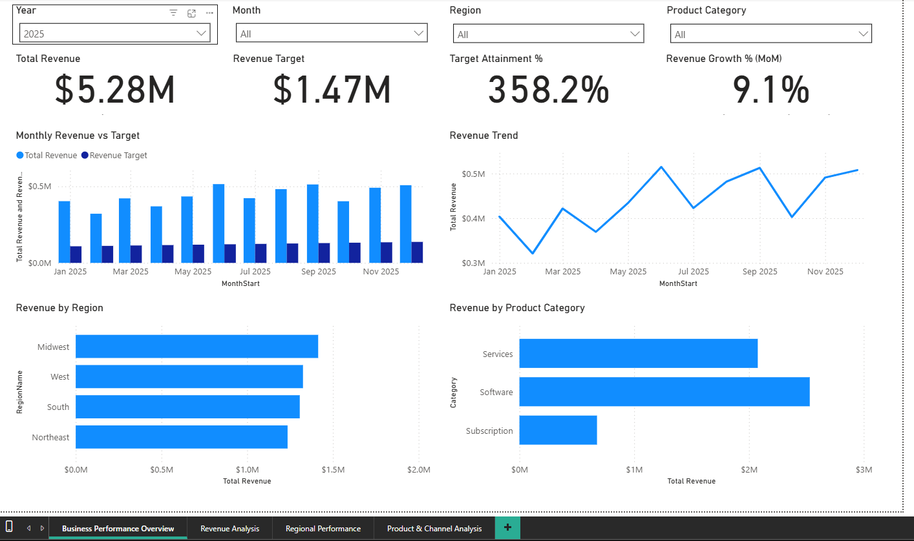
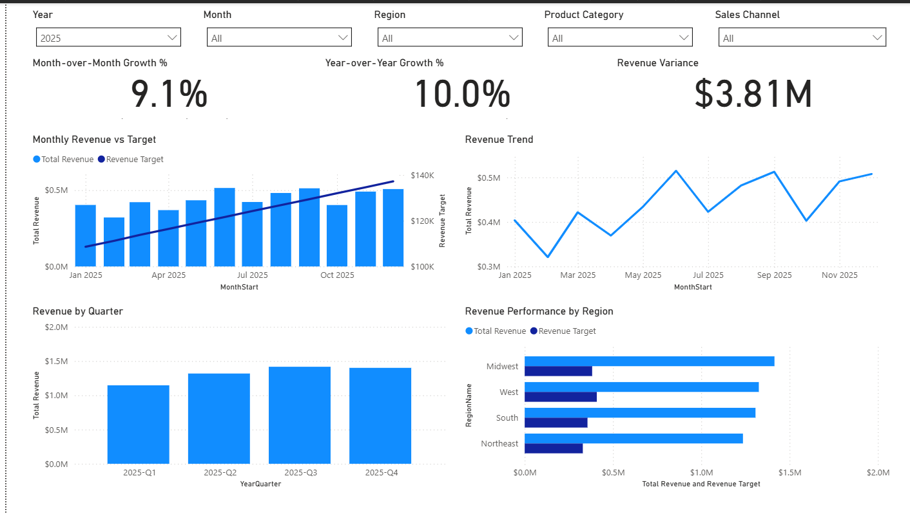
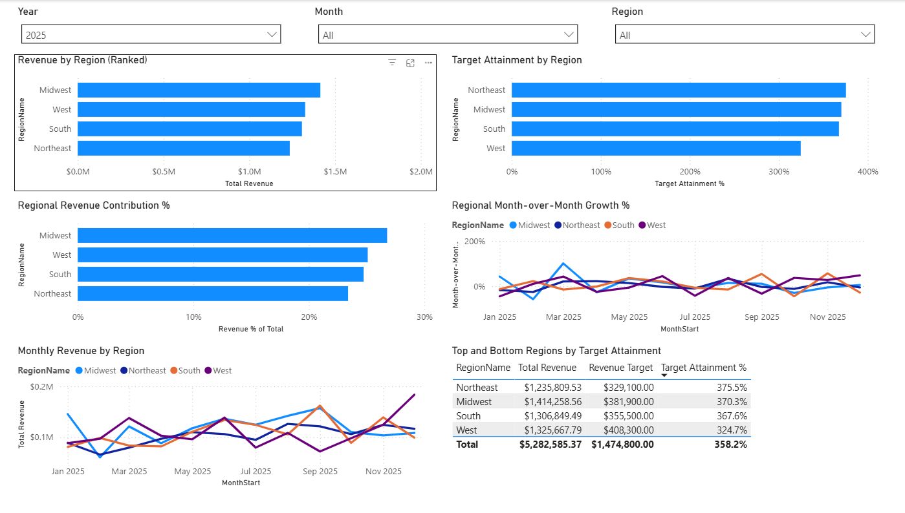
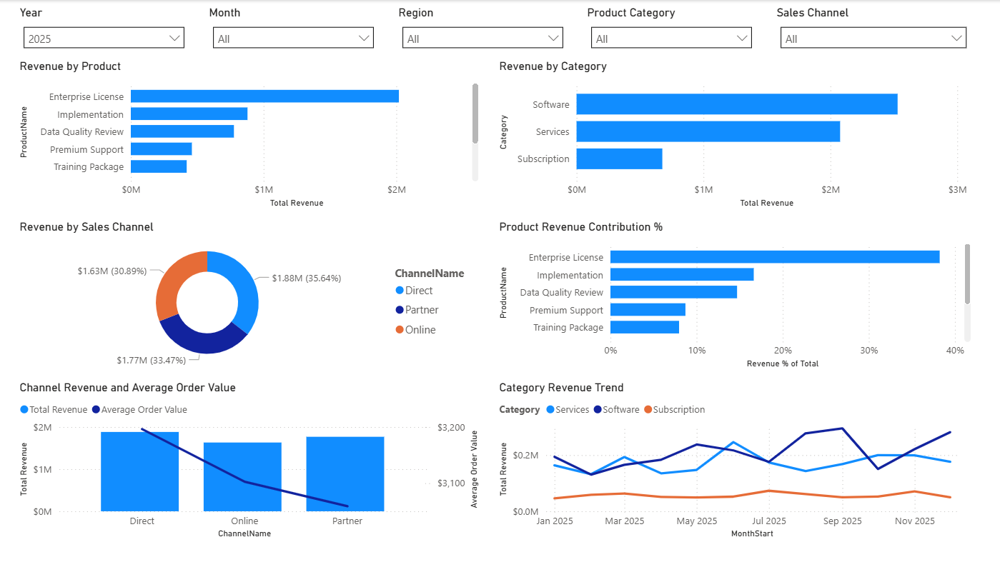
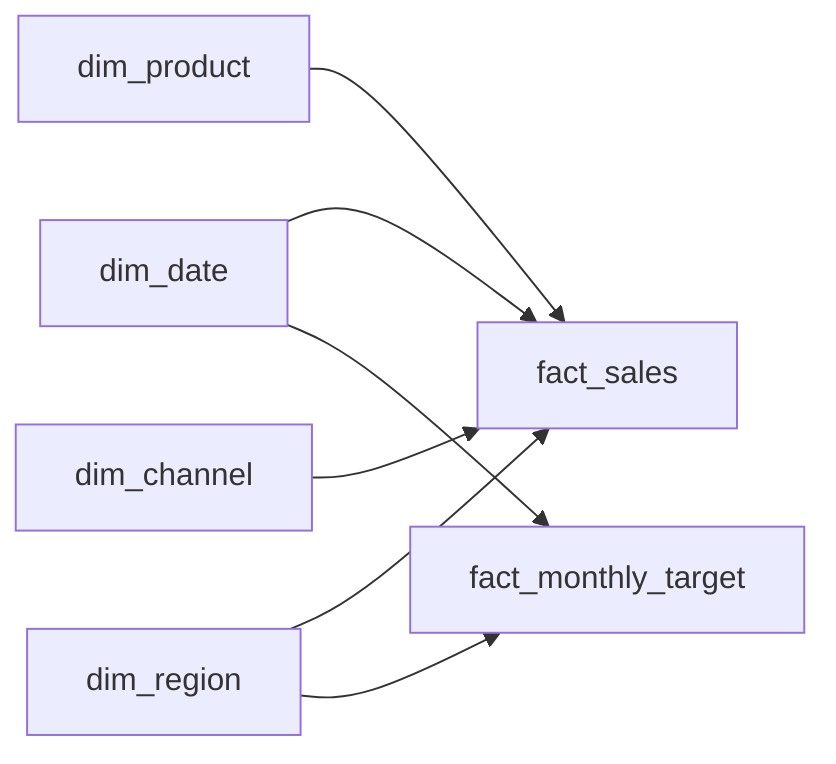

# Business Performance Dashboard

An executive Power BI dashboard for exploring synthetic sales and monthly revenue targets across time, regions, products, categories, and sales channels. The repository is a Power BI Project (PBIP): report and semantic-model definitions are stored as editable PBIR and TMDL files alongside the CSV source data.

> **Portfolio demonstration only:** every dataset in this project is synthetic, generated for portfolio and dashboard demonstration. It does not represent real customers, transactions, business results, or forecasts.

## Business objectives

- Give leaders a concise view of revenue, target attainment, and recent growth.
- Compare monthly actual revenue with monthly regional targets.
- Explore revenue trends and performance across regions.
- Understand actual revenue composition by product, category, and channel.
- Demonstrate a reproducible Power BI project using text-based report and model definitions.

## Dashboard features

- Four report pages with shared date, region, product-category, and channel filters where appropriate.
- Revenue and target KPIs, target attainment, monthly growth, variance, and time comparisons.
- Monthly actual-versus-target analysis, trend charts, quarterly views, regional comparisons, and product/channel breakdowns.
- Calendar attributes covering January 2023 through December 2025, including year, quarter, month, and chronological sort columns.
- A star-schema-style model with sales and monthly targets as separate fact tables.

## Report pages

1. **Executive Overview** — revenue, target, attainment, monthly growth, monthly actual versus target, revenue trend, revenue by region, and revenue by product category.
2. **Revenue Analysis** — monthly actual and target, revenue trend, month-over-month and year-over-year growth, variance, quarterly revenue, and regional comparison.
3. **Regional Performance** — ranked regional revenue, target attainment, regional contribution and growth, monthly regional trends, and regional ranking.
4. **Product & Channel Analysis** — revenue by product and category, revenue by channel, contribution, channel comparison, and category trend.

Screenshots captured from the report are included below and in the `screenshots` folder.

### Executive Overview



### Revenue Analysis



### Regional Performance



### Product & Channel Analysis



## Data and synthetic-data notes

The `data` folder contains all source CSVs:

| Dataset | Grain / role |
|---|---|
| `fact_sales.csv` | Synthetic sales rows with order date, product, region, channel, units, and unit price. Revenue is calculated as units multiplied by unit price. |
| `fact_monthly_target.csv` | Synthetic monthly revenue targets by month and region. |
| `dim_date` | Generated in Power Query for every calendar day from 2023-01-01 through 2025-12-31. |
| `dim_region.csv` | Region lookup. |
| `dim_product.csv` | Product and category lookup, including base price. |
| `dim_channel.csv` | Sales-channel lookup. |

Sales and target values are synthetic. The 2023 and 2024 rows were generated from the existing synthetic patterns, alongside retained 2025 data. Annual revenue and targets were designed for approximately 10% year-over-year growth, with monthly variation. This is a data-generation characteristic, not a forecast or claim about a real business. The included files contain 5,079 sales rows and 144 monthly target rows. Source-level validation found no duplicate order IDs or duplicate month-region target keys. Annual synthetic revenue is $4,365,773.01 (2023), $4,802,350.31 (2024), and $5,282,585.37 (2025); annual targets total $1,218,842.97, $1,340,727.28, and $1,474,800.00, respectively.

Targets are monthly and regional. There are no product-, category-, or channel-level targets. Target comparisons should therefore be interpreted at month/quarter/year and region levels; product and channel filters affect sales actuals only.

## Data model architecture

The semantic model uses a conventional dimensional layout:



Active many-to-one relationships filter the fact tables from the dimensions. The date dimension filters sales by `OrderDate` and targets by `TargetMonth`; region filters both fact tables. Product and channel dimensions filter sales only. The separate target grain prevents multiplying target values across products or channels.

### Core measures

The model defines explicit measures in TMDL. Key measures include:

- **Sales:** `Total Revenue`, `Total Orders`, `Units Sold`, `Average Order Value`, `Revenue per Unit`, `Revenue Rank by Product`, `Revenue % of Total`.
- **Targets:** `Revenue Target`, `Target Attainment %`, `Revenue Variance`, `Revenue Variance %`.
- **Time intelligence:** `Current Month Revenue`, `Previous Month Revenue`, `Month-over-Month Growth %`, `Year-to-Date Revenue`, `Previous Year Revenue`, `Year-over-Year Growth %`, `Current Month Target`, and `YTD Target`.

Revenue is centralized in `[Total Revenue]`:

```DAX
Total Revenue =
    SUMX ( fact_sales, fact_sales[Units] * fact_sales[UnitPrice] )
```

Growth and attainment ratios use `DIVIDE` so a zero or missing denominator returns blank instead of a divide-by-zero error. Month and year calculations use the shared `dim_date` calendar. Monthly targets are aggregated from their monthly regional grain.

## Technology stack

- Power BI Desktop and Power BI Project (PBIP)
- PBIR report definition (JSON)
- TMDL semantic model definitions
- Power Query M for CSV ingestion and date generation
- DAX measures for revenue, targets, and time intelligence
- CSV source datasets

No additional runtime or package dependencies are required to open or refresh the Power BI project.

## Repository structure

```text
.
├── Business Performance Dashboard.pbip
├── Business Performance Dashboard.Report/
│   ├── definition.pbir
│   ├── definition/
│   │   ├── pages/                 # Four page definitions and visual JSON
│   │   ├── report.json
│   │   └── version.json
│   └── StaticResources/           # Built-in report theme resource
├── Business Performance Dashboard.SemanticModel/
│   ├── definition.pbism
│   ├── definition/
│   │   ├── tables/                # Table schemas, DAX measures, and M partitions
│   │   ├── relationships.tmdl
│   │   ├── expressions.tmdl       # Shared CSV data-folder parameter
│   │   ├── model.tmdl
│   │   ├── database.tmdl
│   │   └── cultures/
│   └── diagramLayout.json
├── data/                          # All five synthetic CSV source files
├── screenshots/                   # Report-page screenshots
├── DASHBOARD_ARCHITECTURE.md      # Design and interaction specification
├── README.md
└── .gitignore
```

The PBIP entry point uses relative report/model references. The model's CSV queries use the shared `pDataFolder` parameter instead of a developer-specific absolute path.

## Setup and refresh

1. Clone or download the repository and install a compatible version of Power BI Desktop with PBIP support.
2. Open the PBIP entry point in Power BI Desktop. Keep the report and semantic-model folders together as committed; their project references are relative.
3. Before the first data refresh, configure the `pDataFolder` Power Query parameter to the local absolute path of the cloned repository's `data` folder. In Power BI Desktop, open **Transform data**, select **Manage Parameters**, update `pDataFolder`, and apply the change. This one-time local setting is intentionally not tied to any particular computer.
4. Refresh the model. If prompted, use the **Organizational** privacy level for local CSV files or the setting appropriate for your Power BI Desktop environment.
5. Confirm that years 2023, 2024, and 2025 are available in the report filters.

The parameter is shared by all five CSV queries. The date dimension is generated in M and does not read a CSV. Each CSV query appends its required filename to the folder selected in `pDataFolder`.

## Portability and repository hygiene

- No machine-specific path is stored in the committed Power Query definitions. Each developer sets the one local `pDataFolder` parameter after cloning.
- The report-to-model link uses the PBIP relative-reference structure; retain the project entry point, report folder, and semantic-model folder together.
- Source CSV files are intentionally included so the model can be refreshed and reproduced.
- Power BI Desktop local settings and imported model cache are excluded through `.gitignore`; they are regenerated locally.
- Screenshots are static examples from the included report and may not reflect a later local refresh.

## Known limitations

- Product, category, and channel targets are not present in the source data, so target attainment is not meaningful for those breakdowns.
- The `Revenue % of Total` measure removes product, region, and channel filters in its denominator; it represents share of business revenue within the selected date context.
- The project requires the local `pDataFolder` parameter to be configured before refreshing CSV sources. Opening the PBIP alone does not infer the cloned directory automatically.
- Validate the report in Power BI Desktop after refreshing with the locally configured parameter.
